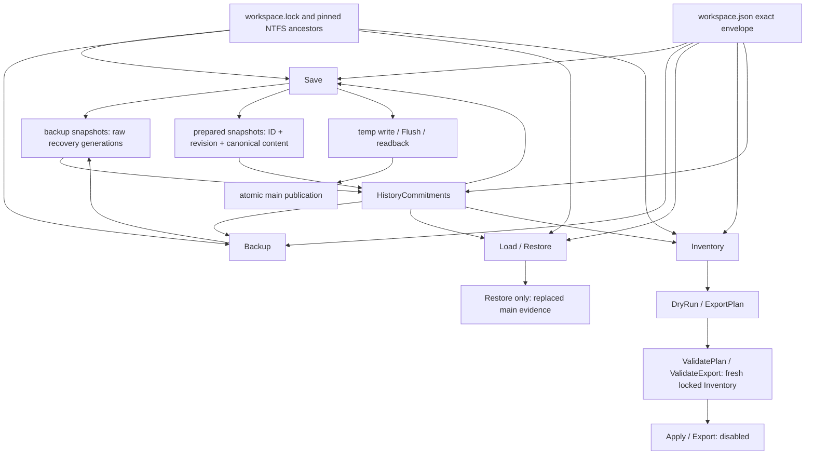

# ADR-0011: Content-bound history checks and gates for safe history compaction

- Status: Proposed
- Date: 2026-10-13
- Owners: Niceskys (acceptance), AI implementation (code and automated evidence)
- Supersedes: none
- Superseded by: none

## Context and scope decision

Latest main is ec43366ab3b86b54bac9e311b5f7d9ebb2fa9b6d, the squash merge of #36. ADR number checked against main and read-only trees of open Drafts #31–#33; no 0011 collision. ADR-0009 and ADR-0010 remain Proposed. This independent E3-4A increment implements history content checks and executable compatibility/capacity evidence. It **does not implement compaction, a new format, or migration**, and does not claim completion of E3-4. The 256-file restriction remains a merge/daily-use integration gate.

A single production compaction PR would combine a new disk reader, raw-preserving migration, old-client fence, native directory ownership, generation publication, archive retirement and crash recovery. None can be justified by a main format bump alone. Split E3-4A (this independently reversible v1 safety increment) from a subsequent protocol/migration increment and E3-4B (long-term archive management). Do not approve a lossy retention policy implicitly. This PR tightens refusals on contradictory/unreadable history; it does not change accepted snapshot content or Item authority.

## Actual dependency graph and quota cause

Before this increment, Save read all prepared records but compared content only at the requested revision, Backup checked main alone, valid-main Load did not scan history, Restore checked backup conflicts independently then prepared high water, and Inventory checked cross-family conflicts. This allowed contradictory earlier prepared records and backup/prepared contradictions to be missed by mutations. The new shared in-memory content witness removes those specific gaps. Lifecycle keeps its stricter namespace/global budget policy; there is still **no single proved compacted disk state** across all operations.

The first Save creates one prepared and one initial backup. Each subsequent distinct Save appends predecessor backup and a prepared snapshot, without deleting anything. With small snapshots, 256 successful saves exhaust both families. The 257th distinct Save refuses archive publication with TooLarge. A prepared family with 257 files blocks history checks; a backup family with 257 files blocks Backup/Restore and recovery selection. A valid main can still be read as a diagnostic view with a structured history error/read-only flag. Restore needs another prepared record and therefore can also refuse at exactly 256 even when all existing records decode. Inventory caps enumeration at 1026 plus lookahead and aggregate reads at 64 MiB; it can refuse earlier than E3-2 per-family 64 MiB scans. Temp/evidence/unknown namespace pressure still makes plans incomplete. Increasing any constant would postpone, rather than resolve, these dependencies.

## Implemented decision and threat review

HistoryCommitments binds one Workspace identity and every observed revision to SHA256 of the canonical existing v1 DTO. It checks *all* observed pairs, including older conflicting records not requested by this Save. Gaps are allowed, equal content duplicates are accepted, and a requested matching revision retains retry semantics unless a higher trusted revision makes it stale. Save/Backup/Restore cannot proceed past unreadable, corrupt, future or partial backup/prepared records. Restore's floor includes main, all understood backups and prepared reservations; overflow refuses publication. Inventory uses the same content comparison, while preserving its existing stricter ownership/read-budget gate.

A readable valid main is retained as a diagnostic Workspace when history refuses trust: Load preserves Normal state for a normal main, returns the actual history Error and IsReadOnly=true, and does not repair or erase it. Read-only backup recovery remains possible for diagnosis; it cannot authorize a lossy rewrite. Callers must examine Error and IsReadOnly, not State alone. Existing partial-main quarantine and future-header refusal are unchanged.

Threats reviewed: equal-revision ambiguity, cross-Workspace confusion, forged/high-water-only summaries, stale retry after failed publication, revision gaps/overflow, unknown historical coverage, old-client rollback, namespace/link substitution, unbounded scanning, and misleading success diagnostics. SHA256 is an integrity/content comparison, **not authentication** or proof of ownership. A forged valid envelope is still untrusted data; it cannot grant launch capability or deletion authority. No arbitrary config-derived names, export destinations, asset reads, resource writes, new directories or maintenance rights are introduced. Storage limits/native handles/lock/fault stages remain intact. Read counters are internal test observations of successful logical reads and wildcard enumeration entries, not device I/O or telemetry.

## Candidate sustained protocol, not yet enabled

Preferred direction for further review: immutable bounded raw-byte history segments with per-record family/source identity, length, raw digest, Workspace/revision/canonical digest when understood; a bounded hot delta; generation manifests with exact covered source set and segment digests; one verified atomic root publication point. Unknown/quarantined/damaged originals remain exact evidence and cannot become gaps. An interval alone cannot prove completeness when revisions have gaps. A scalar maxRevision cannot prove equal-revision content. An index must be a reconstructible accelerator over verified immutable sources, not the only copy of history.

Before moving an original, stage a recoverable raw copy, Flush(true), reopen through native validated handles, verify length/digest/source identity and complete manifest coverage. Publish a complete new root only after all dependencies validate. Crash before publication selects complete old state; after publication validates complete new state; missing/mixed/truncated dependencies reject mutation. Retiring originals needs a separate replayable, recoverable transaction and a verified old-client fence. Copy-first duplicates consume temporary headroom; near-full-disk refusal must preserve the old root and all sources. No multi-file Move/Delete sequence is assumed atomic. File.Replace only publishes one namespace entry; Flush(true) does not prove physical power-loss durability.

Alternatives: cold directories alone fail old-client history visibility; one mutable integer loses content commitments; a mutable single index creates a large failure domain; database transactions could coordinate index rows but do not by themselves fence independently running v1 file clients or preserve unknown raw bytes. Raw immutable segments plus manifests are a candidate, not an accepted product protocol. No pruning, irreversible field loss, or changed retry semantics is approved.

## Migration, downgrade and crash gates

Executable pre-E3-4 source is pinned at 6687bc39d060029e8f0a692419694ffa3c5a7a29 (E3-2) and ec43366ab3b86b54bac9e311b5f7d9ebb2fa9b6d (E3-3). The test harness compiles each exact source and invokes its actual store in a separate .NET process with the full v1 fixture. Synthetic future data is explicitly **not a shipped v2**. A main-only version bump blocks old clients while that main is complete; when missing/corrupt, an unrecognized cold high-water revision 1000 is ignored and old Restore can publish revision 43. A future/corrupt prepared sentinel blocks the tested old mutation paths, but this is **not a complete migration fence proof**: atomic installation ordering, repeat restart, file loss, quota failure, mixed generations, old Backup/Load behavior, and native ownership need a full design/implementation proof.

A leftover v1 main also permits old Save below cold high water when the fence is absent; old Backup still appends a v1 backup even with a future/corrupt prepared fence. Therefore that sentinel is not full old-client isolation. Production v1→v2 migration remains absent and disabled. There is no index repair, generation switch or archive move in this PR, hence no claimed migration commit/rollback/crash result. A future migration must preserve exact v1 unknown fields, shared Items, RemovedItems/RemovedSpaces, partially quarantined objects and damaged evidence without reserialization; coordinate the fence and root under workspace.lock; retain recoverable source generations; test old executables with complete/missing/corrupt new main at every cut point. Unknown future formats must never auto-downgrade. If old writing cannot be fenced, block migration. Do not use a newly written spec/ADR as evidence that those gates passed.

## Retention, costs and support boundaries

All original files stay. No historical backup, unknown evidence, external resource or managed asset is deleted. Public Apply/Export remain unconditionally disabled. Archives, if implemented later, still consume finite disk; no promise of infinite saves or unlimited retention. Future user-approved cleanup requires an independent ownership/dependency/authorization/rollback review.

The implemented check rereads/canonicalizes up to both bounded families for Save/Backup/Load, increasing cost versus valid-main fast Load and prepared-only Save. Same-protocol Release capacity tools compare before/after, explicitly record failed attempts and refused Restore, total disk capacity/free space, retained files/bytes and timing. Internal counters separately record successful logical read bytes/files and enumerations; metadata/read failures and physical storage I/O are not inferred. This cost buys consistency checks, **not quota relief**. A >10% regression must be explained and remains subject to review; no product performance gate closes here.

Production storage remains fixed local Windows NTFS only; Linux is an owned-fixture logic test, not NTFS support. Windows Server CI validates the existing atomic file publication/native/process boundary; Windows 11 real-user desktop, physical power loss/full device, long device/filter/cache operation and UI integration remain open. No new-format support, archive transaction, 1000 successful saves or physical durability is claimed.

## Validation and rollback

[Evidence and explicit unmet gates](../E3_4_HISTORY_SAFETY_EVIDENCE.md) records the full original 637 tests and 16 additional cases, immutable legacy processes, same-protocol capacity attempts, real native fault tests, command exit gates and uploaded artifacts. Original C# test bodies remain unchanged. No tests skipped/disabled. Failures remain recorded. No independent human security approval is implied by these automated tests.

Rollback: revert this increment only; leave every file intact. Disk format/schema remain v1. E3-2/E3-3 can still read the same bytes, but reverting loses the stronger historical conflict refusals; returning to an older executable is not a safety recommendation for contradictory histories. There is no migration to reverse, and no cleanup step. Keep all ADRs Proposed and PR Draft; no automatic merge.
